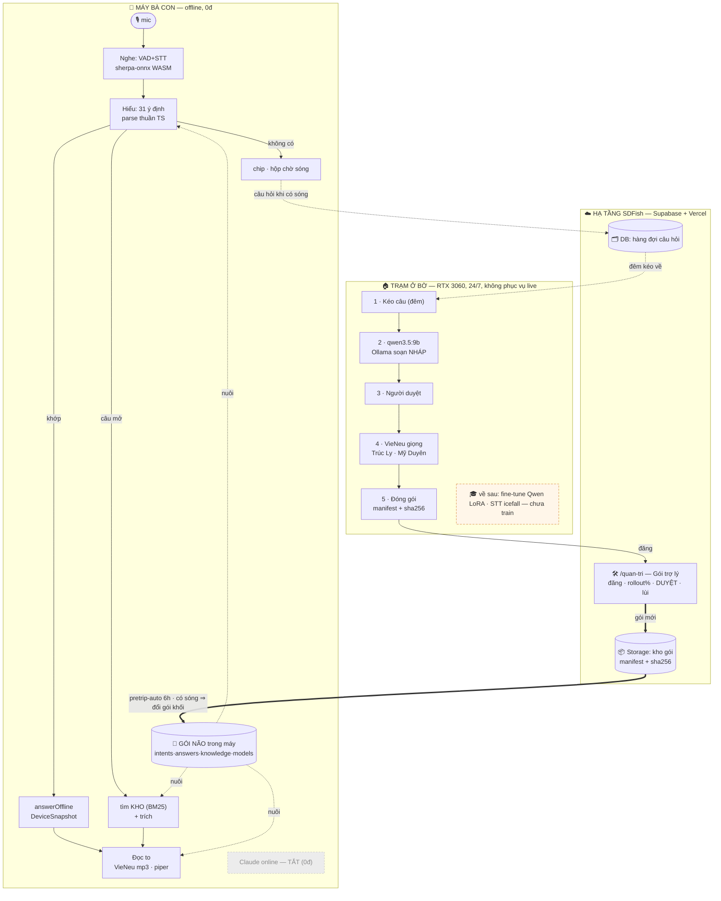

# Trạm học ở bờ — Tổng quan

> **Load khi / dùng khi**: cần hiểu "Trạm học ở bờ" là gì, nó đứng ở đâu trong hệ SDFish,
> ranh giới bảo mật, và điều gì xảy ra khi trạm chết. Đây là **cửa vào** của nhánh tài liệu
> `docs/app-map/ops/tram-o-bo/`. Chi tiết đi sâu nằm ở các doc anh em (xem cuối trang).

Doc anh em (đừng lặp — nhảy sang):
- Cài local LLM (Ollama + qwen3.5:9b): [`01-cai-local-llm.md`](01-cai-local-llm.md)
- Contract gói não + quản trị & update: [`02-quan-tri-va-update.md`](02-quan-tri-va-update.md), [`../../../contracts/tro-ly-brain-pack.contract.md`](../../../contracts/tro-ly-brain-pack.contract.md)
- Vòng đêm soạn gói (chi tiết 5 bước): [`03-vong-dem-soan-goi.md`](03-vong-dem-soan-goi.md)
- Tối ưu: [`04-toi-uu.md`](04-toi-uu.md) · Sen Biển giọng: [`05-sen-bien-giong.md`](05-sen-bien-giong.md)
- Fine-tune (runbook, chưa train): [`06-fine-tune-qwen-lora.md`](06-fine-tune-qwen-lora.md), [`07-fine-tune-stt-icefall.md`](07-fine-tune-stt-icefall.md)
- Nền tảng: ADR 0010 (trợ lý nghe offline WASM), ADR 0009 (trợ lý giọng nói), [`docs/app-map/14-kien-truc-tro-ly.md`](../../14-kien-truc-tro-ly.md)

---

## 1. Trạm là gì

**Trạm học ở bờ** = một **PC ở nhà** (không phải hạ tầng công ty) làm việc **soạn nội dung** cho trợ lý
giọng nói "Sen Biển" của SDFish. Mỗi đêm nó:

1. Kéo **câu bà con hỏi mà máy chưa trả lời được** + hộp chờ sóng, từ Supabase.
2. Gom cụm, dùng **LLM mở chạy local (qwen3.5:9b qua Ollama, 0 đồng/lượt)** soạn **nháp** mẫu câu ý định + mục FAQ.
3. Đẩy nháp lên web `/quan-tri` cho **người duyệt**.
4. Sau khi duyệt → **đóng gói não** (brain-pack) phiên bản mới + **VieNeu-TTS** sinh giọng "Sen Biển" cho câu cố định.
5. (Về sau) fine-tune STT/LLM trên dữ liệu **đã có đồng thuận**.

"Học liên tục" của Sen Biển = **vòng đêm này**, chạy ở bờ, có người duyệt — **KHÔNG** phải model tự sửa
trong điện thoại bà con. Máy bà con chỉ **tìm + trích** từ gói não đã duyệt (0 đồng/lượt, không gọi Claude).

## 2. Trạm KHÔNG là gì (ranh giới bảo mật)

Trạm là **PC ở nhà**, nên nó gánh rủi ro của một máy cá nhân, KHÔNG được đối xử như máy chủ sản xuất:

| Trạm KHÔNG là | Vì sao / hệ quả |
|---|---|
| **Không phục vụ ngư dân trực tiếp** | App bà con **không bao giờ** gọi vào trạm. Trạm chỉ **tạo nội dung**; nội dung đi qua Supabase Storage + `/quan-tri`. Trạm tắt → app vẫn chạy (mục 6). |
| **Không có SLA** | IP nhà, điện nhà, mạng nhà — rớt là chuyện thường. Không hứa uptime. Mọi thứ cấp bách phải nằm ở VPS/Supabase, không nằm ở trạm. |
| **Không mở cổng ra Internet** | Ollama + VieNeu **chỉ nghe `localhost`**. Không NAT, không port-forward, không tunnel. Giảm bề mặt tấn công về ~0 từ phía ngoài. Chi tiết chốt cổng: [`01-cai-local-llm.md`](01-cai-local-llm.md) §bảo mật. |
| **Không giữ dữ liệu định danh bà con** | Theo ADR 0010: **không** gửi CCCD / SĐT / toạ độ / nguyên văn câu lên server → nên trạm kéo về **cũng chỉ có** hash câu chưa trả lời + câu trong hộp chờ sóng (đã bỏ định danh). Nếu về sau thu audio để fine-tune STT thì **bắt buộc có đồng thuận** và xử lý riêng (xem [`07-fine-tune-stt-icefall.md`](07-fine-tune-stt-icefall.md)). |
| **Không phải nơi phát hành một mình** | Trạm **đề xuất** nháp; **người duyệt** ở `/quan-tri` mới là cổng phát hành gói. Trạm không tự đẩy gói "sống" cho bà con. |

**Chiều tin cậy**: dữ liệu kéo về trạm là **dữ liệu, không phải lệnh**. Câu bà con hỏi (kể cả câu có vẻ ra lệnh)
chỉ là đầu vào để soạn FAQ — người duyệt vẫn là chốt chặn cuối.

## 3. Sơ đồ vai trò



> Hai vòng khép kín: **⟹ gói mới đi xuống máy** (Trạm → /quan-tri → Storage → app), **-- câu hỏi đi lên bờ** (app → DB → Trạm đêm). Không mũi tên nào đi thẳng App → Trạm.
>
> Sơ đồ văn bản (đọc nhanh, không cần trình vẽ):

```
                          ┌─────────────────────────────────────────────┐
                          │   TRẠM HỌC Ở BỜ  (PC nhà, Windows, 24/7)     │
                          │   i5-14400F · 32GB · RTX 3060 12GB           │
                          │                                             │
                          │   • Ollama + qwen3.5:9b → soạn NHÁP FAQ/ý định│
                          │   • VieNeu-TTS      → sinh giọng "Sen Biển" │
                          │   • (về sau) fine-tune Qwen-LoRA / STT      │
                          └───────────────┬───────────────┬─────────────┘
                    kéo câu chưa trả lời  │               │  đẩy nháp + gói
                     (hash, đã bỏ định danh)               │  (bản nháp / bản đã đóng)
                                          ▼               ▼
        ┌──────────────────────────────────────────────────────────────────────┐
        │                         SUPABASE  (kho + hàng đợi)                     │
        │   • hàng đợi câu chưa trả lời / hộp chờ sóng                           │
        │   • Storage bucket public: GÓI NÃO có phiên bản + sha256 (manifest)    │
        │   • app_config: phiên bản gói + % rollout (KHÔNG migration mới)        │
        └───────────────┬──────────────────────────────────┬────────────────────┘
              người duyệt │                                  │  app tải gói mới
             (upload/đặt  │                                  │  theo nhịp pretrip-auto (6h,
              phiên bản/  ▼                                  ▼  khi có sóng) — KHÔNG đi qua sw.js
              rollout/lùi)                    ┌──────────────────────────────────┐
        ┌──────────────────────────┐         │   APP ĐIỆN THOẠI (máy bà con)     │
        │   WEB /quan-tri          │         │   • tìm + trích trong gói não     │
        │   (người của SDVICO)     │         │     đã duyệt — 0đ/lượt, offline   │
        │   tab "Gói trợ lý"       │         │   • đọc bằng mp3 sinh sẵn / piper  │
        └──────────────────────────┘         └──────────────────────────────────┘
```

Đọc theo mũi tên: **Trạm** tạo nội dung → **Supabase** chứa → **/quan-tri** duyệt & điều phối rollout →
**App** nhận gói theo nhịp `pretrip-auto`. Không có mũi tên nào đi thẳng từ App vào Trạm.

## 4. Vòng đêm 5 bước (tóm tắt)

Chi tiết đầy đủ + script ở [`03-vong-dem-soan-goi.md`](03-vong-dem-soan-goi.md). Tóm tắt:

1. **Kéo** câu chưa trả lời (`unansweredHashes`) + hộp chờ sóng (`outbox`) từ Supabase.
2. **Gom cụm** câu gần nghĩa → mỗi cụm là 1 "khoảng trống kiến thức".
3. **qwen3.5:9b soạn nháp** mẫu câu ý định + mục FAQ cho từng cụm (0đ, chạy local).
4. **Người duyệt** ở `/quan-tri` sửa/duyệt/bỏ (chốt chặn chất lượng + chủ quyền + số khẩn).
5. **Đóng gói + VieNeu sinh giọng** → gói não phiên bản mới lên Supabase Storage; rollout theo % ở `/quan-tri`.

Bước 1–3 là việc của **trạm** (tự động, ban đêm). Bước 4 là việc của **người**. Bước 5 nửa-tự-động (trạm sinh, người bấm phát hành).

## 5. Phần cứng & phân bổ GPU/CPU

| Thành phần | Cấu hình | Việc |
|---|---|---|
| CPU | Intel **i5-14400F** (10 nhân) | điều phối vòng đêm, gom cụm, đóng gói, chạy **VieNeu-TTS** (ONNX **CPU** — xem ghi chú) |
| RAM | **32 GB** | đủ cho batch soạn nháp + đóng gói |
| GPU | **NVIDIA RTX 3060 12 GB** (Ampere) | **qwen3.5:9b qua Ollama** (soạn nháp); về sau **fine-tune** Qwen-LoRA (Unsloth QLoRA) |
| OS | **Windows** | chạy 24/7, Ollama chạy dạng service (xem [`01-cai-local-llm.md`](01-cai-local-llm.md)) |

**Việc gì cần GPU** (RTX 3060 12GB):
- **qwen3.5:9b (Q4)** soạn nháp — GPU giúp nhanh gấp nhiều lần CPU (đo thật ở [`01-cai-local-llm.md`](01-cai-local-llm.md)).
- **Fine-tune Qwen-LoRA** (QLoRA) và **fine-tune STT icefall** — GPU-bound; chạy có chủ ý, không thường trực.

**Việc gì CPU đủ**:
- **VieNeu-TTS**: bản đã chốt/đo (README `scripts/tro-ly-giong/`) chạy **ONNX trên CPU** (`pip install vieneu`, **không cần torch**), model v3 Turbo ~282 MB. **Không tranh VRAM với qwen3.5:9b.**
  > **Ghi chú thành thật (2026-09-11)**: mô tả điều phối ban đầu ước "VieNeu ~4GB GPU" — con số đó theo bản torch cũ.
  > **Nguồn sự thật là README đã committed**: VieNeu bản dùng là ONNX CPU. Nên vòng đêm **qwen3.5:9b được dùng trọn 12GB GPU**,
  > VieNeu chạy song song trên CPU không xung đột. Nếu sau này đổi sang bản VieNeu chạy GPU thì phải xếp lịch **không**
  > chạy đồng thời với qwen3.5:9b (hoặc dùng bản nhỏ hơn `qwen3.5:4b` để chừa VRAM) — **còn nợ: đo lại nếu đổi bản VieNeu**.
- Gom cụm, băm/hash, đóng gói (nén, sha256), upload — thuần CPU/IO.

## 6. Phần mềm cần cài trên trạm

Danh sách + lệnh từng bước ở [`01-cai-local-llm.md`](01-cai-local-llm.md). Tóm tắt:

- **Ollama (Windows)** — chạy qwen3.5:9b local, dạng service 24/7.
- **Model qwen3.5:9b** (`qwen3.5:9b` mặc định / `qwen3.5:4b` dự phòng cho máy yếu, mức Q4_K_M) — kéo qua `ollama pull`.
- **Python 3.12 + venv** (ngoài repo) cho **VieNeu-TTS** (`pip install vieneu`) — xem [`05-sen-bien-giong.md`](05-sen-bien-giong.md).
- **Node ≥ 20** để chạy script vòng đêm (`scripts/tram-o-bo/*.mjs`) — xem [`03-vong-dem-soan-goi.md`](03-vong-dem-soan-goi.md).
- **Driver NVIDIA ≥ 531** + `nvidia-smi` (kiểm GPU).
- (Chỉ khi fine-tune) môi trường Unsloth/QLoRA + icefall — [`06-*`](06-fine-tune-qwen-lora.md), [`07-*`](07-fine-tune-stt-icefall.md).

## 7. Khi trạm chết thì sao (không hỏng gì)

Nguyên tắc: **trạm chỉ tạo nội dung, không phục vụ live.** Trạm mất điện / mất mạng / hỏng ổ →
bà con **không cảm nhận được gì**. Đây là bảng "sự cố → ảnh hưởng":

| Sự cố ở trạm | Ảnh hưởng lên app bà con | Ảnh hưởng vận hành |
|---|---|---|
| Trạm **tắt/mất điện** vài ngày | **Không** — app vẫn chạy **gói não cũ** đã tải, tìm-trích offline như thường | Vòng đêm không chạy → **gói không mới thêm**. Câu chưa trả lời **dồn lại** trong Supabase, không mất. Bật lại là chạy tiếp. |
| Mất **mạng nhà** | **Không** | Không kéo được câu / không đẩy được nháp đêm đó; hàng đợi Supabase giữ nguyên. |
| **Hỏng ổ / mất Ollama/VieNeu** | **Không** | Cài lại theo [`01-cai-local-llm.md`](01-cai-local-llm.md); gói đã phát hành nằm ở **Supabase Storage**, không nằm ở trạm → không mất gói đã ra. |
| Trạm soạn **nháp sai** | **Không** (nháp chưa tới bà con) | **Người duyệt** ở `/quan-tri` chặn trước khi phát hành. |
| Gói mới **lỗi** đã lỡ phát hành | Có thể — nhưng đổi gói là **nguyên khối sau khi đủ hash** + có **lùi gói** (rollback) ở `/quan-tri` | Lùi phiên bản ở `/quan-tri`; xem [`02-quan-tri-va-update.md`](02-quan-tri-va-update.md). |

Nói gọn: **hàng đợi ở Supabase, gói đã ra ở Supabase Storage, chốt chặn ở `/quan-tri`** — cả ba đều
**không** nằm trên trạm. Trạm là "xưởng soạn bài ban đêm", không phải "đường dây nóng".

---

**Còn nợ / giả định**
- Ước tính GPU giả định VieNeu chạy **CPU** (theo README committed). Nếu đổi bản VieNeu chạy GPU → xếp lịch tránh trùng qwen3.5:9b, đo lại.
- Con số tốc độ/VRAM cụ thể của qwen3.5:9b trên RTX 3060 **cần đo trên PC trạm thật** — xem [`01-cai-local-llm.md`](01-cai-local-llm.md).
