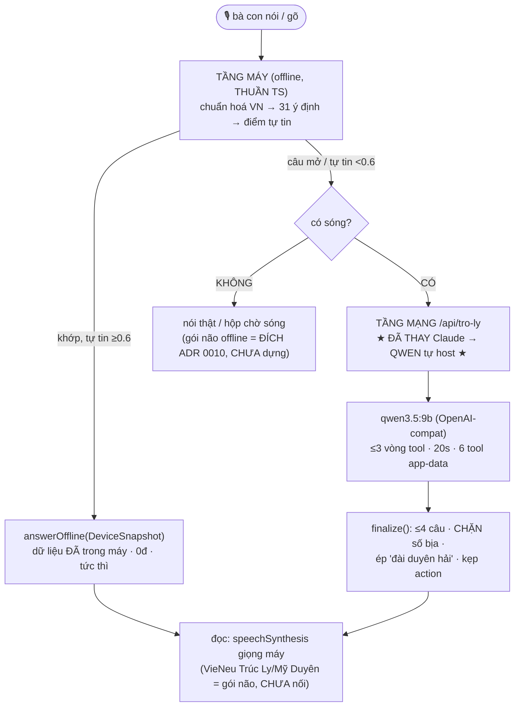
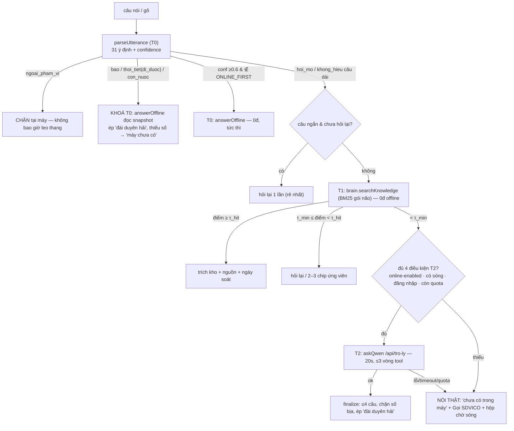

# 10 — Kiến trúc "Sen Biển AI" (Qwen): rà soát + thiết kế

> **Load khi**: bàn chuyện engine trợ lý (online/offline), Qwen server, fine-tune/RAG, đạt-mức-frontier cho ngư dân, hoặc test/giám sát/tối ưu AI. Hồ sơ THIẾT KẾ (đề xuất) — nguồn quyết định là ADR; đây là bản rà soát toàn cảnh + roadmap.
>
> **Vì sao**: chủ dự án 2026-09-12 yêu cầu rà soát toàn bộ cấu trúc + đề xuất (1) logic online/offline thông minh, (2) Qwen server train/fine-tune/token, (3) đạt mức Claude/ChatGPT bằng dữ liệu chuyên biệt ngư dân + dữ liệu app; cùng test/giám sát/tối ưu.
>
> **Liên quan**: [ADR 0009](../../../adr/0009-tro-ly-giong-noi.md) (2 tầng gốc) · [ADR 0010](../../../adr/0010-tro-ly-nghe-offline-wasm.md) (gói não offline) · [14-kien-truc-tro-ly](../../14-kien-truc-tro-ly.md) §6 (server, §6.7 Qwen) · [tram-o-bo 01/03/04/06/08/09].

---

## Phần 0 — RÀ SOÁT: bức tranh thực tế hôm nay (2026-09-12)

### 0.1 Ba tầng — cái gì ĐANG chạy, cái gì CHƯA

| Tầng | Trạng thái | Chi phí | Cần sóng | Vai trò |
|---|---|---|---|---|
| **T0 — máy hiểu 31 ý định** (TS thuần) | ✅ chạy | 0đ | Không | Mọi việc "trong máy": thời tiết/bão đã lưu, giấy tờ, bảo dưỡng, giỏ, giá. Tức thì. |
| **T1 — gói não offline (BM25 retrieval)** | ❌ CHƯA dựng (ADR 0010 P1) | 0đ | Không | Câu mở trả bằng KHO KIẾN THỨC đã duyệt trong máy — đích thay tầng mạng |
| **T2 — tầng mạng Qwen** | ✅ **vừa dựng** (31dfb84) | ~0đ vendor (điện/GPU) | Có | Câu mở/không hiểu → qwen3.5:9b + tool app-data |
| ~~Claude opus-5~~ | ⏸️ giữ code, chọn engine qua `assistant_engine` | 5/25 USD/1M | Có | Phương án; ~50–150 USD/ngày/1000 ngư dân → lý do đổi Qwen |

### 0.2 Tầng mạng Qwen — đã kiểm THẬT hôm nay
- `server/qwen.ts` (additive, không đụng `claude.ts`): gọi `{qwen_base_url}/chat/completions` chuẩn OpenAI; chọn engine qua `app_config.assistant_engine=qwen|claude` (+`qwen_base_url/model/api_key`).
- **Tái dùng nguyên** `SYSTEM_PROMPT` + `finalize` (hậu kiểm an toàn) + 6 tool + `executeTool` của claude.ts/tools.ts → engine đổi, **an toàn giữ nguyên**.
- Đã đo trên máy trạm: qwen3.5:9b (Ollama, 100% GPU, 53,8 tok/s). Test end-to-end trong dev server: `POST /api/tro-ly` → 200, gọi tool `tin_bao`, trả tiếng Việt xưng "bác" + "đài duyên hải", quota đếm.

### 0.3 Sáu tool app-data (dữ liệu SỐ SỐNG, chính xác — không để LLM bịa)
`don_cua_toi · gia_ca · gia_dau · thoi_tiet_cang (≤3 ngày) · tim_san_pham · tin_bao` — gọi thẳng lib server, kết quả ≤2KB. Đây là **RAG dữ liệu app sẵn có**: số sống lấy từ nguồn thật, model chỉ diễn đạt.

### 0.4 Guardrail an toàn (`finalize`, chạy trên text cuối — độc lập engine)
Cắt ≤4 câu · **chặn số bịa** (số mà không tool nào chạy + không phải số "lưu" của máy → thay câu chung) · **ép "nghe đài duyên hải"** cho câu bão/sóng · kẹp `action` vào tập đóng (navigate/search/call) · KHÔNG bao giờ đặt/huỷ đơn/xoá bằng giọng.
> ⚠️ Nợ đã biết: `WEATHER_WORDS` regex `\b` ASCII bỏ sót "áp thấp"/"gió" có dấu; LLM live vẫn có thể bịa phần định tính (finalize chỉ chặn số) — hướng đích ADR 0010 (retrieval kho-đã-duyệt) mới chặn bịa triệt để.

### 0.5 Giọng, Trạm, hạ tầng
- **Giọng** (chốt 2026-09-08): VieNeu-TTS, **Trúc Ly** (Bắc, cả Bắc+Trung) + **Mỹ Duyên** (Nam). Sinh ở bờ cho câu cố định của gói não. App HIỆN đọc `speechSynthesis` giọng máy (VieNeu là cho T1 chưa dựng).
- **Trạm ở bờ** (RTX 3060 12GB, Ollama+qwen3.5:9b, 24/7): soạn nháp gói não ban đêm + người duyệt; KHÔNG phục vụ live. [tram-o-bo 00–09].
- **Hạ tầng**: app prod VPS/Vercel — KHÔNG chạm được Ollama PC nhà trừ tunnel/host riêng. DB Supabase `znzgugvfhgmiszqgjulk`.

### 0.6 Ba câu hỏi lớn chủ dự án đặt (Phần 1–3 dưới trả lời)
1. Logic **online↔offline** thông minh (tài nguyên/mạng/tự tin/tương tác).
2. **Qwen server** train/fine-tune/quản-lý-token cho thông minh hơn.
3. Đạt mức **Claude/ChatGPT trong miền nghề cá** bằng dữ liệu chuyên biệt + dữ liệu app; test/giám sát/tối ưu.

---

## Phần 1 — Sen Biển online↔offline: logic chuyển thông minh

> Căn cứ: `use-assistant.ts` (`ask()`), `parse.ts` (`CONFIDENCE_OFFLINE=0.6`), `answer.ts`, `speech.ts`, `server/{qwen,claude}.ts`, `types.ts` (`NEVER_ONLINE`/`ONLINE_FIRST`), ADR 0010. WebSearch 2026-09-12.

**Tóm tắt**: định tuyến hôm nay chỉ **2 nấc** (T0 máy → T2 online). ADR 0010 thêm **T1 trích kho offline**. Thiết kế = **thác bậc tự-tin rẻ-trước-đắt-sau**: T0 (0đ, <5ms) → T1 (0đ, offline) → T2 (GPU + cần sóng) → nói thật. **Bất biến**: câu an toàn (bão/đi-được/thời tiết) **khoá cứng T0**, không để nấc sinh-chữ (T2) hay trích-kho (T1) quyết định.

### 1.1 Cây quyết định 4 nấc

**Ngưỡng BM25 `τ_hit`/`τ_min` phải hiệu chỉnh trên eval set** (BM25 không chuẩn hoá sẵn) — theo hướng **abstention-first/evidence-gated** (best-practice RAG 2026): điểm không đủ → **nói "chưa có"**, không cố trả lời. **Nghe (STT) chia chung tín hiệu**: có gói WASM+SIMD → sherpa-onnx offline; chưa gói+có sóng → Web Speech (cần mạng); mất sóng+chưa gói → chip+ô gõ.

### 1.2 Tín hiệu tài nguyên → quyết định

| Tín hiệu | Đo (web/webview thật) | Dùng |
|---|---|---|
| Chắc chắn offline | `navigator.onLine===false` (false là thật) | bỏ cổng T2; mic → lỗi sau `OFFLINE_GRACE_MS 3s` |
| "Có thể online" | `onLine===true` (**thấp tin** — true ≠ gọi được) | không tin suông, **probe bằng chính request** |
| Mạng yếu | `effectiveType`/`rtt` (**chỉ Chromium; iOS/Firefox KHÔNG có**) | gợi ý mềm, **không dựa một mình** |
| Kết quả THẬT | chính lần gọi + `timeoutSignal` (client 25s, mic 3s) | **nguồn tin cao nhất** |
| Pin | Battery API (**chỉ Chrome-Android; iOS không**) | chỉ gợi ý mềm, KHÔNG cổng chính |
| WebGPU/SIMD/RAM | feature-detect | quyết mời gói WASM / có LLM-trên-máy không |
| Chỗ trống | `storage.estimate()` + `persist()` | thiếu chỗ gói ~64–70MB → không tải |
| Premium | `snapshot.premium` | chỉ mở **nội dung** (>3 ngày, cá), KHÔNG đổi nấc |

**Luật gộp mạng**: kết quả-request-thật > `effectiveType` > `onLine`. Không chặn T2 chỉ vì báo "2g"; thử với ngân sách ngắn, để timeout tự phân loại. iOS: chấp nhận chỉ có `onLine` + kết quả thật.

### 1.3 Có nên chạy LLM nhỏ TRÊN MÁY? — **KHÔNG cho v1** (giữ Option C đã bác ADR 0010)
2026 WebGPU đã thật hơn (1–4B ~10–40 tok/s trên flagship), nhưng: (a) **an toàn** — LLM sinh-chữ bịa số bão (đúng cái T0/T1 tránh); (b) **máy đích Android ≤4GB / iPhone 12** không kham 3–4B; (c) pin/nhiệt cả ngày nắng; (d) +0,5–2GB. Cửa hẹp đợt sau: LLM nhỏ chỉ làm **rerank cho T1** (chọn đoạn kho), **không sinh chữ**.

### 1.4 Ngân sách + mục tiêu phân bổ
T0 parse <5ms (0đ) · T1 BM25 vài ms (0đ) · T2 Qwen ~13s+tool, ngân sách 20s (GPU+sóng) · fallback tức thì. **Mục tiêu: T0 ≥70%, T1 ≥20%, T2 ≤10%, "chưa hiểu" ≤5%** — mỗi lượt T2 là điện/GPU + cần sóng. Đo: tỉ lệ mỗi nấc (`reply.source`), rơi mạng giữa chừng, p90, `micNetworkErrors`, hiệu chỉnh τ. Test: câu an toàn KHÔNG bao giờ rời T0; e2e offline → Network TRỐNG.

## Phần 2 — Qwen server: train, fine-tune, quản lý token

> Căn cứ: `server/{qwen,claude,tools,key,quota}.ts`, `app-config-keys.ts`, `14 §6/§6.7`, ops `01/04/06`. WebSearch 2026-09-12 (nguồn cuối mục). Số tốc độ/VRAM **phải đo trên PC trạm/VPS thật**.

### 2.1 Hosting / serving PROD — ba lựa chọn

| Tiêu chí | **(A) PC bờ + tunnel** | **(B) GPU VPS + vLLM** ⭐ | **(C) API Qwen host** |
|---|---|---|---|
| Chi phí compute | **0đ** (điện ~150–200W, vài trăm k/tháng) | Cố định ~**$290–400/tháng** (A6000/L4) | Theo token: qwen3.8-flash **$0,14/$0,42** per M tok |
| Độ tin / SLA | ❌ IP nhà, mất điện/mạng là sập; tranh GPU với vòng đêm | ✅ SLA, uptime cao | ✅ SLA vendor |
| Bảo mật | ⚠️ ngược ADR 0010 nếu lộ Ollama; **Tailscale** an toàn hơn public tunnel | ✅ server mình kiểm soát | ⚠️ **dữ liệu bà con ra Alibaba Cloud — cờ chủ quyền** |
| Độ trễ | trung bình (tunnel + Ollama serial) | **thấp** (cùng vùng, continuous batching) | thấp–trung (mạng ra ngoài) |
| Vận hành | nặng (PC nhà, NSSM còn nợ) | vừa | **nhẹ nhất** (đổi `qwen_base_url`+key) |
| 0đ/lượt | ✅ | ✅ (cố định) | ❌ (theo token, vẫn rẻ hơn opus rất nhiều) |

So Claude opus-5 cũ (~$50–150/ngày/1000 ngư dân): cả ba rẻ hơn hẳn. Ước (C) qwen3.8-flash ~$0,001/lượt → 1000×30 lượt ≈ **$30/ngày**; (B) cố định ~$13/ngày **bất kể lưu lượng** + giữ dữ liệu ở mình.

**Reachability** (app prod KHÔNG chạm localhost bờ): (A) Vercel→Cloudflare/Tailnet→PC:11434 (outbound-only) — *beta*; **(B) Vercel→`https://llm.sdvico.vn/v1` (vLLM + reverse proxy + Bearer) — khuyến nghị prod** (`qwen.ts` đã gửi `Authorization: Bearer` khi có `apiKey`, khớp sẵn); (C) endpoint vendor.

**Concurrency RTX 3060** *(ước, CHƯA đo trên trạm)*: Ollama `NUM_PARALLEL=1` = **tuần tự** → nhiều người hỏi cùng lúc phải xếp hàng, KHÔNG hợp live. **vLLM** (continuous batching + PagedAttention) web đo **8–20×** thông lượng Ollama cùng phần cứng, NHƯNG 12GB VRAM (trọng số 6,6GB → ~5GB KV) chặn số slot ⇒ ước **~2–6 lượt đồng thời** — phải đo `--max-model-len`/`--gpu-memory-utilization`. Nhịp ngư dân thưa → 3060+vLLM đủ **beta**; quy mô → VPS VRAM lớn. **Ollama = dựng&test (đúng vai ở trạm); vLLM = phục vụ.** Đổi endpoint là xong, **code KHÔNG đổi** (đều OpenAI-compat).

### 2.2 Làm thông minh hơn — thang leo (rẻ trước)

| Bậc | Làm gì | Khi nào | Đo |
|---|---|---|---|
| **1. Prompt + few-shot** | `SYSTEM_PROMPT` đã tốt; thêm 2–4 ví dụ nếu lạc giọng | mặc định, thử trước | eval: đúng giọng/khuôn |
| **2. RAG** | (a) 6 tool app-data = số sống (ĐÃ là RAG); (b) thêm tool **tra kho kiến thức nghề cá** (BM25 gói não, duyệt ở bờ) | câu mở cần kiến thức tĩnh | tỉ lệ trả đúng có nguồn; "chưa có" giảm |
| **3. Fine-tune LoRA** | QLoRA Unsloth qwen3.5:9b (runbook 06) | CHỈ khi ≥30% nháp bị sửa ≥4 tuần **và** ≥300 cặp duyệt **và** prompt vài vòng không dứt | chấm mù base vs fine-tune |
| **4. Model lớn hơn** | qwen3.8-27B nếu lên VPS VRAM lớn | bậc 1–3 vẫn đuối + có VRAM | A/B chất lượng vs chi phí |

**Nguyên tắc: RAG trước fine-tune.** Fine-tune ở doc 06 là cho **model thầy soạn gói ở bờ** — KHÁC model phục vụ live, đừng lẫn.

### 2.3 Quản lý token/context — 🔴 phát hiện quan trọng

Một lượt live ước **~5.000–7.000 token** (system+tools ~1.200–1.500 · snapshot ≤8KB ~2.500–3.200 · ≤3 vòng tool ~500–800/vòng). Trạm mới đo **`num_ctx 4096`** (cho vòng đêm) — **live sẽ TRÀN/cắt ngầm snapshot** → model mất dữ liệu, trả lời sai KHÔNG BÁO.
- `qwen.ts` hiện **không gửi `num_ctx`** → qua Ollama OpenAI-compat rơi về **mặc định Ollama (thấp)** ⇒ **nguy cơ cắt ngầm trên prod**. vLLM đặt context lúc khởi động (`--max-model-len`).
- **Khuyến nghị**: prod Ollama `num_ctx ≥ 8192` (per-request/Modelfile); vLLM `--max-model-len ≥ 8192`. **Đo VRAM ở 8192 trên 3060** (4096 đã 8,7GB). `// nợ: qwen.ts truyền num_ctx`.

Đòn bẩy tiết kiệm: **cache system prompt** (thứ tự cố-định-đầu đã đúng; vLLM bật APC `enable_prefix_caching`) · `keep_alive` (đã 30m) · **tắt thinking cho live** (qwen3.5 có thinking; `finalize` lọc `<think>` nhưng vẫn tốn token/giờ — `// nợ: tắt thinking`) · không history (đã) · tool output ≤2KB (đã) · nén snapshot (gọi tool thay vì nhồi giá/thời tiết).

**Quota**: 30/ngày là trần mềm (bộ nhớ instance). Qwen tự host **0đ/lượt** → quota không còn để chặn hoá đơn mà **chặn lạm dụng + bảo vệ GPU/hàng đợi** → có thể **nới**, nhưng giữ để 3060 không bị dồn. Đo token in/out qua `usage` (vLLM)/`eval_count` (Ollama) — log chỉ số, không log nội dung. **Chi phí điện/GPU = cố định, không theo lượt → $/lượt biên tế giảm dần khi nhiều người** (lập luận kinh tế để tự host thắng API ở quy mô ≥ vài trăm ngư dân).

### 2.4 Đánh giá + giám sát Qwen

- **Eval set nghề cá** (bắt buộc trước prod): câu thật phủ thời tiết/bão · giá · đơn · tìm món · giấy tờ · câu mở · **ngoài phạm vi (từ chối)** · **bẫy bịa số (phải nói "máy chưa có")**. Chấm: giọng ≤4 câu · gọi đúng tool · **không bịa số** (finalize bắt %) · có "đài duyên hải" · action đúng tập.
- **Giám sát prod**: tỉ lệ số bịa chặn · rơi `khong_hieu` · token/s · **độ trễ p90** · tỉ lệ tool lỗi · VRAM/%GPU/hàng đợi (vLLM `/metrics` Prometheus sẵn — lý do nữa chọn vLLM) · **tỉ lệ chạm trần `num_ctx`** (cắt ngầm).

## Phần 3 — Đạt mức Claude/ChatGPT bằng dữ liệu chuyên biệt + test/giám sát/tối ưu

> Căn cứ: `server/{tools,qwen,claude}.ts`, `assistant/{parse,answer}.ts`, contract gói não, ADR 0010, ops 03/04/06/08/09, `assistant-audit-vectors.test.ts` (108 câu "chú Ba", đã verify). WebSearch 2026-09-12.

**Đặt lại đề bài**: "bằng Claude/ChatGPT" chỉ nói về **tầng MẠNG T2 (Qwen)** — máy bà con chỉ tìm–trích, không sinh chữ. Và T2 **chỉ được gọi ~10–30% lưu lượng** (câu mở/khó); 31 ý định đã nuốt phần lớn. Nên Qwen **không cần giỏi mọi thứ — chỉ cần giỏi ĐUÔI phân phối trong miền nghề cá**. Lợi thế kiến trúc, không phải hạn chế.

### 3.1 Model nhỏ + RAG **ngang frontier TRONG miền hẹp** (có căn cứ 2026)
Nghiên cứu 2026 (Frontiers in Medicine; Winder.ai; BentoML): *SLM + RAG match near-frontier trên tác vụ hẹp, rẻ 10–100×* — **nhưng chỉ trong miền**. Sen Biển chỉ sống trong miền (mọi thứ ngoài đã bị `ngoai_pham_vi` chặn ở T0). **Bốn đòn bẩy rút ngắn khoảng cách 9B vs frontier** (leo thang rẻ trước):

| # | 9B hay lộ | Đòn bẩy | Trạng thái |
|---|---|---|---|
| 1 | không biết **số sống** | **6 tool** app-data | ✅ chạy |
| 2 | không biết **kiến thức tĩnh** nghề cá | 🔴 **domain RAG: tool `tra_kho`** trích `knowledge.v1.json` | ❌ **CHƯA nối vào Qwen** — §3.2 |
| 3 | lạc giọng/dài dòng | **system prompt mạnh + few-shot** | 🟡 prompt tốt, chưa few-shot |
| 4 | **bịa số, quên nhắc an toàn** | **`finalize` guardrail** (độc lập engine) | ✅ chạy |
| 5 | vẫn đuối có hệ thống | fine-tune LoRA | ⏸ nợ có điều kiện (06) |

`finalize()` kéo 9B lên **an toàn ngang frontier** không cần model giỏi hơn (chạy trên text cuối): thay câu bịa số · ép "đài duyên hải" · kẹp action tập đóng. Đây là **runtime guardrail + groundedness** đúng best-practice RAG doanh nghiệp 2026.

### 3.2 🔴 Phát hiện lớn nhất: KHO chưa nối vào Qwen → đề xuất tool `tra_kho`
Kho `knowledge.v1.json` hiện **chỉ tiêu thụ offline bằng BM25** (P1 chưa dựng). **Tầng online Qwen KHÔNG đọc kho** — chỉ có 6 tool + snapshot → câu mở "ướp cá ngừ sao cho tươi" rơi xuống Qwen thì **9B tự bịa từ trí nhớ chung** (đúng cái sợ nhất ở SLM).
**Đề xuất (bậc 2, không thêm dep)**: **tool thứ 7** `tra_kho(q, so_muc≤3) → [{id, traLoi, nguon, ngaySoat, chipMoMan?}]`, executor chạy **chính BM25 của `brain.ts`** trên kho đã duyệt. Qwen chuyển từ "nhớ gì nói nấy" → "trích kho đã duyệt + ghi nguồn". **Một kho, hai đường đọc** (offline BM25 + online tool) — không nhân đôi dữ liệu. Cần `brain.ts` chạy server-side (P1) + 1 faithfulness guard.

### 3.3 Ba nguồn dữ liệu — ranh giới là LUẬT
- **(a) Số sống** (6 tool): giá/gió/sóng/cấp bão/đơn/hạn giấy **CHỈ** từ tool/snapshot, TUYỆT ĐỐI không nhét vào kho (chống bịa + số trong kho cũ mốc). *Lỗ phủ sóng*: chưa có tool `giay_to`/`bao_duong`/`con_nuoc` cho online → nếu rơi xuống Qwen, finalize chặn (an toàn nhưng "chưa trả lời được").
- **(b) Kho kiến thức tĩnh** (bảo quản cá, nhớt/máy, lưới, thủ tục, mùa vụ, cảng): soạn+duyệt ở bờ (vòng đêm 03), `nguon`+`ngaySoat` bắt buộc, `validate-brain-pack` gác.
- **(c) Dataset fine-tune**: cặp (câu bà con → mục người chốt), để dành. ⚠️ dataset fine-tune **model thầy soạn gói** (trạm) KHÁC dataset fine-tune **Qwen T2 prod** (trả lời bà con) — đừng trộn.

### 3.4 Đánh giá "đạt mức frontier" — đo được
- **Eval set nghề cá** (tái dùng): 108 câu chú Ba + 230 vector + **80–150 câu MỞ mới** (gom từ `outbox` có đồng thuận + `unansweredHashes` cao), mỗi câu có "câu vàng" người duyệt viết.
- **Hai tầng chấm**: (1) **LLM-judge** (Claude/Kimi, **CHỈ lúc soạn/CI, chi phí MỘT LẦN**, không vào prod) chấm thô rộng, chống bias (đảo A/B, chấm mù); (2) **người duyệt SDVICO** chốt ca an toàn + ca judge bất đồng. *Judge đồng thuận người ~85% nhưng bias vị trí/độ dài, calibration miền yếu → phải tự đo trên miền nghề cá.*
- **A/B Qwen vs Claude** (giữ Claude qua cờ làm đối chứng vàng): **an toàn = cổng NHỊ PHÂN 100%** (bão có "đài duyên hải", không bịa số — không đạt là KHÔNG thay, bất kể điểm khác); các chỉ số mềm (nhận-thẳng ≥ Claude−5, tool đúng ≥90%, faithfulness ≥95%, p90 ≤6s) là thang.

### 3.5 Test · Giám sát · Vận hành · Tối ưu (tổng, bao 3 trục)
**Kim tự tháp test**: unit (finalize/parse — 108+230 câu đã có; **thiếu**: finalize đường qwen + integration Ollama thật cho askQwen) → integration Qwen thật (nhóm B của [08](08-qa-full-luong.md)) → e2e app (offline → Network TRỐNG, ADR 0010 P4) → nghiệm thu TAY 3 vùng.
**Giám sát prod — hai lớp (đừng trộn)**: **A. Chất lượng câu** (tỉ lệ finalize bắt bịa, ép đài duyên hải, "chưa trả lời được", tool đúng — đếm ở route, KHÔNG log nguyên văn) · **B. Hạ tầng Qwen** (p90 ≤6s, token, tok/s, GPU/VRAM, concurrency — Trục 2, vLLM `/metrics`) · **C. Trạm** ([09](09-giam-sat.md), không khẩn) · **D. Vòng học** (`unansweredHashes`, mốc gỡ tầng mạng <10% trong 3 tháng).
**Tối ưu theo dữ liệu thật (vòng học NT12)**, thứ tự rẻ→đắt: nội dung kho (đếm cao trước) → prompt/few-shot → **tra_kho** → quant/serving → fine-tune. **Đo trước khi chỉnh.**
**Faithfulness guard cho `tra_kho`** (đề xuất): nếu câu Qwen chứa khẳng định không khớp `traLoi` trích được → hạ về chính `traLoi` + nguồn (per-claim groundedness kiểu nghèo, không thêm thư viện — như `NUMBER_CLAIM` hạ câu bịa số).

## Phần 4 — Roadmap + quyết định cần chủ dự án chốt

### 4.1 Kiến trúc hợp nhất (một câu)
**Thác bậc tự-tin**: T0 máy (31 ý định, 0đ) → T1 kho offline (BM25, 0đ) → **T2 Qwen tự host** (câu mở, ~10% lưu lượng) → nói thật. **Câu an toàn khoá cứng T0** + `finalize` là lưới thứ hai. Qwen chỉ cần giỏi **đuôi phân phối trong miền nghề cá** — đạt được bằng **tool (số sống) + kho `tra_kho` (kiến thức) + finalize (không bịa)**, không cần model bằng Claude.

### 4.2 Gỡ mâu thuẫn "tắt tầng mạng" (ADR 0010) vs "Qwen làm prod"
Hai tư thế **hoà giải được** bằng khung T1-first của Trục 1: **T1 (kho offline) luôn thử trước; T2 (Qwen) chỉ là lưới khi T1 trượt VÀ cờ bật**. Giai đoạn đầu **bật T2** (Qwen) để lấp lỗ hổng khi kho còn mỏng; **giảm dần** khi kho phủ (đo bằng tỉ lệ T2). Không phải "Qwen thay kho" mà "Qwen đỡ trong lúc kho lớn dần". → `assistant_online_enabled` mặc định **bật (Qwen)** giai đoạn này, lộ trình về tắt khi kho <10% miss trong 3 tháng.

### 4.3 Roadmap (rẻ trước — mỗi bước có cổng đo)

| Đợt | Việc | Vì sao / cổng |
|---|---|---|
| **N1 — vá ngay (Qwen prod chạy đúng)** | (a) 🔴 **truyền `num_ctx ≥8192`** vào `qwen.ts` + đo VRAM 3060 (chống cắt ngầm snapshot) · (b) **tắt thinking** cho tầng live · (c) few-shot vào system prompt nếu Qwen lạc giọng | rủi ro "trả lời sai không báo"; rẻ, code nhỏ |
| **N2 — nối kho vào Qwen** | 🔴 **tool `tra_kho`** (BM25 `brain.ts` server-side) + faithfulness guard | đòn bẩy domain-RAG lớn nhất; hết bịa kiến thức tĩnh. Phụ thuộc P1 `brain.ts` |
| **N3 — hosting prod** | chọn (B) **GPU VPS + vLLM** (SLA, `/metrics`, dữ liệu ở mình) hoặc (A) PC bờ + **Tailscale** (beta). Code KHÔNG đổi (OpenAI-compat) | app prod không chạm localhost bờ; concurrency 3060 hạn chế |
| **N4 — eval + giám sát** | bộ eval nghề cá (108+230+150 câu) · A/B Qwen vs Claude (an toàn = cổng nhị phân) · giám sát 2 lớp (chất lượng câu · hạ tầng Qwen) | chốt "thay được Claude" bằng số, không cảm tính |
| **N5 — vòng học + fine-tune** | đếm `unansweredHashes` → soạn kho → phát gói. Fine-tune LoRA **chỉ khi** ≥300 cặp + ≥30% nháp bị sửa ≥4 tuần (06) | tối ưu theo dữ liệu thật; fine-tune là bậc cuối |

### 4.4 Quyết định cần chủ dự án chốt (gộp 3 trục)
1. **Hosting prod Qwen**: (B) GPU VPS+vLLM [khuyến nghị: SLA, dữ liệu ở mình, ~$290–400/tháng cố định] · (A) PC bờ+**Tailscale** [0đ, beta] · (C) API Qwen host [rẻ/lượt nhưng **dữ liệu bà con ra Alibaba Cloud — cờ chủ quyền**]. *Trục 2.*
2. **`assistant_online_enabled` mặc định**: bật Qwen giai đoạn đầu (đề xuất) hay giữ tắt theo ADR 0010? *Trục 1 — mâu thuẫn sống, chỉ chủ dự án quyết.*
3. **Nối kho vào Qwen (`tra_kho`)**: làm không? (đòn bẩy lớn nhất chống bịa; cần P1 `brain.ts`). *Trục 3.*
4. **Ngưỡng "thay được Claude"** + giữ Claude làm đối chứng vàng bao lâu. *Trục 3.*
5. **Trần quota khi Qwen (0đ)**: giữ 30 hay nới (chỉ để bảo vệ GPU, không còn chặn hoá đơn)? nâng lên bảng `assistant_usage`? *Trục 2.*
6. **Tắt thinking Qwen3.5 cho live** (khuyến nghị tắt — độ trễ). *Trục 2.*
7. **Mời STT offline (gói WASM)** cho mọi máy đủ SIMD hay chờ đo phone P0 bước 2. *Trục 1.*
8. **Lỗ phủ sóng tool online** (giấy tờ/bảo dưỡng/con nước): thêm tool hay chấp nhận finalize chặn. *Trục 3.*

### 4.5 Nợ kỹ thuật gom (không sửa hồ sơ này — cần code/đo riêng)
- `qwen.ts`: truyền `num_ctx`; tắt thinking. `finalize`: `WEATHER_WORDS` regex `\b` ASCII bỏ sót từ có dấu; faithfulness guard cho `tra_kho`.
- `brain.ts` (P1 ADR 0010) **chưa dựng** → chặn cả T1 offline lẫn tool `tra_kho`.
- Chưa có: unit `finalize` đường qwen; integration Ollama thật cho `askQwen`; hiệu chỉnh `τ_hit/τ_min` BM25; eval set nghề cá; đo p90/concurrency/num_ctx-8192 trên hạ tầng thật.

---

**Last updated**: 2026-09-12 — Rà soát + thiết kế đầy đủ (Phần 0–4), tổng hợp từ 3 trục (routing · Qwen server · parity+data+ops). Nguồn quyết định vẫn là ADR 0009/0010; đây là bản đồ đường + điểm quyết.
